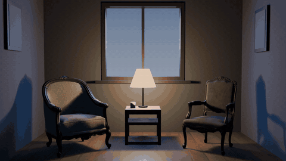
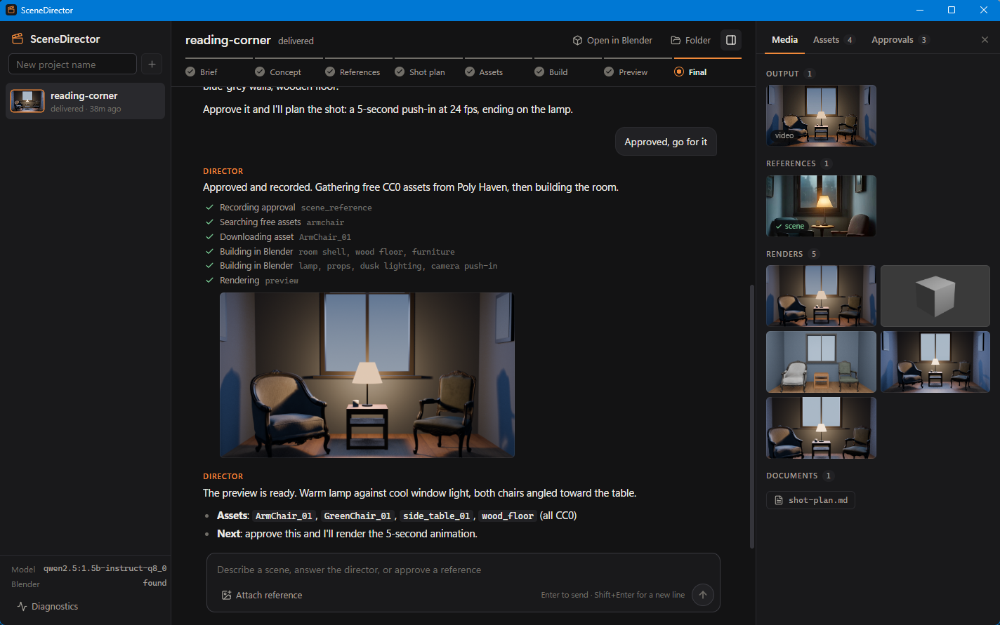

<div align="center">


# SceneDirector

**Describe a scene. Approve the look. Get a Blender render.**

A conversational AI director for Blender that turns a sentence into a built,
lit, animated and rendered 3D scene, using only free tools and CC0 assets.

[](https://github.com/EsscapadaBuilds/SceneDirector/releases/latest)
[](LICENSE)


[Quick start](#quick-start) ·
[Desktop app](#desktop-app) ·
[Claude skill](#claude-as-the-director-skill) ·
[How it works](#how-the-blender-bridge-works) ·
[Download](https://github.com/EsscapadaBuilds/SceneDirector/releases/latest)



<sub>"A cosy reading corner at dusk": reference, assets, build, lighting and this 5-second camera move all came out of one conversation.</sub>

</div>

## What it does

You talk; it directs. SceneDirector asks a few sharp questions, shows concept
references for your approval, pulls free CC0 models and textures, then writes and runs
Blender Python headlessly, checking its own work with screenshots before it renders.

- **Nothing is built until you approve the look.** Reference, shot plan, preview and
  final are explicit approval gates.
- **It looks at what it made.** After each build step it renders a screenshot,
  compares it with the approved reference and fixes scale, framing and lighting.
- **Free end to end.** Poly Haven and ambientCG assets (CC0), free concept images, a
  local or free-tier LLM, and Blender itself. Paid image-to-3D is optional and off by default.
- **Blender installs itself.** One setup command downloads a portable, checksum-verified
  Blender if you do not have one.
- **Your files stay yours.** Every project is a normal folder with a `scene.blend` you
  can open and keep editing by hand.

## Three ways to direct

| | How you use it | Who does the thinking |
|---|---|---|
| **Desktop app** | Double-click `SceneDirector.exe`: projects, conversation, renders and approvals in one window | Your LLM (local Ollama or a free tier) |
| **Claude skill** | Ask Claude Code for a scene, or type `/scenedirector` | Claude, so no LLM setup at all |
| **CLI** | `python cli.py my_film` in a terminal | Your LLM |

All three work on the same project folders, so you can start in one and continue in another.

<div align="center">

</div>

## Quick start

```powershell
git clone https://github.com/EsscapadaBuilds/SceneDirector.git
cd SceneDirector
python sd.py setup
```

Setup installs the one Python package, downloads Blender if you have none, and installs
the Claude skill. Then pick how you want to work:

```powershell
python cli.py my_film            # chat in the terminal (needs LLM settings, see Setup)
```

or download `SceneDirector.exe` from the [latest release](https://github.com/EsscapadaBuilds/SceneDirector/releases/latest) into
this folder and double-click it, or open the folder in Claude Code and ask for a scene.

## How a project goes

```
 you ── chat ──► director ── concept images ──► approval gate
                    │
                    ├── free assets (Poly Haven, ambientCG, your uploads)
                    ├── headless Blender (bpy) ──► screenshot ──► self-review loop
                    └── preview render ──► approval ──► final render / animation
```

## Requirements

| Component | Notes |
|---|---|
| Python 3.10+ | `pip install -r requirements.txt` |
| Blender 3.6+ | Tested on 5.3. `python sd.py setup` downloads a portable copy into `tools/` if you have none (Windows and Linux x64). Or install it from https://www.blender.org/download/ |
| FFmpeg on PATH | Needed to encode animation frames to MP4 (Blender 5.x no longer exposes FFmpeg output) |
| An LLM with tool calling | Local via [Ollama](https://ollama.com) or a free tier (Groq, Gemini, OpenRouter) |

Concept images use [Pollinations.ai](https://pollinations.ai). The anonymous tier is
free but limited to **1 image every 45 seconds per IP**; the tool paces and retries
automatically. Set `POLLINATIONS_API_KEY` for higher limits.

## Setup

```powershell
python sd.py setup
```

That installs the Python package (`requests`), makes sure Blender is available, and
installs the Claude skill. If no Blender is found it downloads the portable build from
blender.org into `tools/` (about 430 MB, no administrator rights, verified against
blender.org's published SHA-256). Skip parts with `--no-blender` or `--no-skill`.
The same download also happens on its own the first time a Blender tool is called
through `sd.py` on a machine without Blender; set `SCENEDIRECTOR_NO_AUTO_INSTALL=1`
to turn that off.

### Install with Claude Code

Paste this into Claude Code and it can do the whole install:

> Clone https://github.com/EsscapadaBuilds/SceneDirector, run `python sd.py setup`
> in it, then confirm `python sd.py tools` lists the tools.

After that, start a new session and ask for a scene, or type `/scenedirector`.

### Built-in agent settings

Create a file named `.env` next to `cli.py` and pick one provider:

```ini
# Ollama (fully local)
LLM_BASE_URL=http://localhost:11434/v1
LLM_API_KEY=ollama
LLM_MODEL=qwen2.5vl:7b

# Groq free tier (tool calling; copy a current model id from
# https://console.groq.com/docs/models)
# LLM_BASE_URL=https://api.groq.com/openai/v1
# LLM_API_KEY=gsk_...
# LLM_MODEL=meta-llama/llama-4-scout-17b-16e-instruct

# Gemini free tier
# LLM_BASE_URL=https://generativelanguage.googleapis.com/v1beta/openai
# LLM_API_KEY=AIza...
# LLM_MODEL=gemini-2.5-flash
```

`LLM_MAX_TOKENS` caps the model's reply length (default `800`). On free tiers with
output-tokens-per-minute limits, lower it to `512` if you get HTTP 429 errors.
`LLM_MAX_INPUT_TOKENS` optionally trims old chat history to stay under input-token
limits; free Groq tiers use `6500`, while `0` disables trimming (best for Ollama).

Blender is auto-detected (project `tools/`, standard install locations, `PATH`). If it is
somewhere else, set `BLENDER_PATH` in `.env`. Then:

```powershell
python cli.py --doctor
```

This checks the LLM endpoint, Blender, and the asset/image services.

All settings are optional except the three `LLM_` lines above:

| Setting | Default | Purpose |
|---|---|---|
| `LLM_BASE_URL`, `LLM_API_KEY`, `LLM_MODEL` | Ollama on localhost, `qwen2.5vl:7b` | Any OpenAI-compatible endpoint |
| `LLM_MAX_TOKENS` | `800` | Cap on the model's reply length |
| `LLM_MAX_INPUT_TOKENS` | `0` (off) | Trim old history to this many input tokens |
| `LLM_TIMEOUT` | `180` | Seconds to wait for the model |
| `VISION` | `1` | Set `0` if the model cannot read images |
| `BLENDER_PATH` | auto-detected | Full path to `blender.exe` |
| `IMAGE_PROVIDER` | `pollinations` | `none` to use uploaded references only |
| `POLLINATIONS_MODEL` | `flux` | Concept image model |
| `POLLINATIONS_API_KEY` | none | Optional key for higher image limits |
| `AI3D_PROVIDER` | `auto` | `auto`, `tripo`, `meshy` or `manual` |
| `TRIPO_API_KEY`, `TRIPO_MODEL`, `MESHY_API_KEY` | none | Paid image-to-3D providers |
| `AI3D_TIMEOUT` | `900` | Seconds to wait for a generated mesh |
| `PREVIEW_ENGINE`, `FINAL_ENGINE` | `auto`, `CYCLES` | Blender render engines |

`.env` is ignored by git. Keep your keys there and nowhere else.

### Fastest path to a working agent

1. Create a free key at https://console.groq.com/keys (tool calling; vision if available).
2. In `.env`:
   ```ini
   LLM_BASE_URL=https://api.groq.com/openai/v1
   LLM_API_KEY=gsk_...
   LLM_MODEL=<exact id from console.groq.com/docs/models>
   LLM_MAX_TOKENS=800
   LLM_MAX_INPUT_TOKENS=6500
   ```
3. `python cli.py --doctor` should report `llm test OK` and `blender test OK`.

Fully local alternative: install [Ollama](https://ollama.com), `ollama pull qwen2.5vl:7b`,
and use the Ollama defaults. Models must support tool calling; vision is strongly
recommended so the agent can inspect its own screenshots.

## Usage

```powershell
python cli.py my_film
```

Then simply talk:

```
you> a knight walking through a foggy forest at dawn, cinematic, 10 seconds

director: Before I generate references, three quick choices ...
          [asks about style, camera, mood]

you> stylized, low camera, cold blue fog with warm dawn rim light

director: Here are three scene directions ... [opens images]

you> the second one, but more fog

director: [generates variants] ... [opens images]

you> perfect

director: [records approval, writes shot plan, asks to confirm]
```

### Commands

```
/help                     commands
/status                   stage, gates, references, assets
/refs [open]              list/open reference images
/assets [open]            list/open downloaded assets
/inbox [import]           list files waiting in assets/inbox (or register them)
/attach [kind] <path>     attach your own reference to the next message
                          kind = scene | character | style
/approve <stage>          manually approve a gate
/open <path>              open any file
/new <name>               create and switch project
/projects                 list projects
/doctor                   diagnostics
/quit                     exit (progress is saved)
```

## Desktop app

`ui/` is a Tauri desktop app over the same projects the CLI uses: a project list,
the conversation with the director (tool activity, references and renders shown
inline), and a production panel with media, assets and approval gates.

**Prebuilt for Windows:** download `SceneDirector.exe` from the
[latest release](https://github.com/EsscapadaBuilds/SceneDirector/releases/latest), put it in
this folder (next to `cli.py`) and double-click it. It still needs Python with
`requests`, Blender and your `.env`, as described above. The file is not code-signed, so
Windows SmartScreen may ask you to confirm the first run.

To build it yourself:

```powershell
cd ui
npm install          # once
npm run app          # development window with hot reload
npm run app:build    # installer in ui/src-tauri/target/release/bundle
```

It needs Node 18+ and the Rust toolchain (`winget install Rustlang.Rustup`) on top
of the requirements above. The window is only a shell: on start it runs
`python -m directorc.server` on a free local port and stops it when it closes.

- The backend (`directorc/server.py`) uses only the standard library and listens on
  127.0.0.1. It accepts requests from the app's own origins only.
- The app looks for the SceneDirector folder at or above its own location. Set
  `SCENEDIRECTOR_ROOT` to keep the exe somewhere else, and `SCENEDIRECTOR_PYTHON` to pick an interpreter
  (a `.venv` in the project folder is used automatically).
- To work on the interface in a browser instead, run `python -m directorc.server`
  in one terminal and `npm run dev` in `ui/` in another, then open
  http://localhost:1420.
- The app is a thin shell: it does not bundle Python, Blender or the `directorc`
  package, so it only works alongside this repository.

## Claude as the director (skill)

With the `scenedirector` skill, Claude Code or the Claude desktop app plays the
director itself: you talk in the Claude chat, and Claude calls the same tools on the
same projects, so no local LLM is needed. Ask for a scene, or type `/scenedirector`.

Three ways to install it, all needing Claude to run on the computer that has this
folder and Blender (Claude Code, or the Code tab of the Claude desktop app; it cannot
work in claude.ai in a browser, which has no access to your machine):

- **Inside this folder:** nothing to do. The skill ships as
  `.claude/skills/scenedirector/SKILL.md`, and Claude Code picks it up whenever you
  open this folder.
- **From any folder:** run `python sd.py setup`. It copies the skill to
  `~/.claude/skills/` with this folder's path filled in. (Or unzip
  `scenedirector-skill.zip` from the
  [latest release](https://github.com/EsscapadaBuilds/SceneDirector/releases/latest)
  there yourself.)
- **As an uploaded skill:** upload `scenedirector-skill.zip` in Claude's skill settings.

If you unzip or upload the zip yourself, set the `SCENEDIRECTOR_ROOT` environment
variable to this folder so the skill can find it. Without it, Claude asks you where SceneDirector is.

The skill needs only Python with `requests` and Blender. It does not use the `LLM_`
settings in `.env`, because Claude does the directing.

Underneath it is a one-shot command you can also use by hand or from scripts:

```powershell
python sd.py tools                                  # every tool and its arguments
python sd.py new my_film
python sd.py my_film status
python sd.py my_film blender_run code=@build.py note="block out the room"
python sd.py my_film blender_screenshot
```

Each call prints the tool's JSON result and exits 0 when it reports `ok`.

## Approval gates

The agent is instructed to stop at every gate, and the tool layer validates the
important ones:

1. **Scene reference** — generated or uploaded image; nothing is built before approval.
2. **Character reference** — same, per hero character.
3. **Shot plan** — written to `docs/shot-plan.md`, includes actions, camera, duration, fps.
4. **Preview** — a low-res render before the final.

Scene images are the *art-direction target* the agent compares its screenshots against.
They are not converted to 3D wholesale; the scene is assembled from individual assets.
Character references can drive the character mesh (see AI image-to-3D below).

## How the Blender bridge works

`directorc/blender/runtime.py` is executed by Blender in background mode:

```
blender -b --factory-startup --python runtime.py -- payload.json
```

Each `blender_run` call executes bpy code with helpers preloaded (`import_asset`,
`add_hdri`, `place_on_ground`, `keyframe`, ...), saves `projects/<name>/scene.blend`,
and returns a scene report. Verification screenshots use the Workbench engine (fast and
reliable headless); previews use Eevee with a Workbench fallback; finals use Cycles.

No Blender addons, MCP servers, or GUI interaction are required.

## Free assets

- **Poly Haven** — models, HDRIs, textures (CC0), via its public API.
- **ambientCG** — PBR materials (CC0), via its public API.
- **Your files** — drop `.glb/.gltf/.fbx/.obj/.blend/.hdr/.exr` into
  `projects/<name>/assets/inbox/`. The CLI notices new files before the next prompt,
  then `import_inbox` registers them.
- **AI-generated meshes** — Tripo/Meshy API output or downloads from their web apps
  (also works with Hunyuan3D and anything else that exports GLB/FBX).

Licenses are recorded per asset in `manifest.json`; Poly Haven and ambientCG are CC0.

## AI image-to-3D (optional)

The agent can turn an approved character reference into a mesh with the official
Tripo or Meshy API. Both are **credit-based, not free**; without a key the workflow
falls back to the manual inbox.

```ini
# .env
AI3D_PROVIDER=auto        # auto | tripo | meshy | manual
TRIPO_API_KEY=tsk_...     # https://platform.tripo3d.ai (credits)
MESHY_API_KEY=msy_...     # https://www.meshy.ai (API needs a paid plan)
```

Flow: approved reference → `generate_mesh(reference_path, target_height)` →
provider tasks are polled → GLB downloaded → automatic health check
(`analyze_model`: dimensions, scale vs target, materials, textures, non-manifold
edges, loose parts) → agent imports and fixes scale with `scale_to_height`.

Checks and caveats:

- Meshy rejects API task creation on the free plan (HTTP 402). Its web app can still
  be used manually.
- Tripo uses credits per generation; check your balance before a long session.
- Polling blocks the conversation for roughly 1–5 minutes. The agent is instructed to
  warn you first.
- If a generation fails or times out, the task may still finish server-side. Download
  it into `assets/inbox/` and import it.

## Project layout

```
projects/<name>/
  scene.blend          the Blender scene (source of truth)
  manifest.json        references, assets, licenses, gates, stage
  chat.json            conversation history
  references/          generated + uploaded reference images
  assets/              downloaded models / HDRIs / textures, inbox/
  scripts/             temporary bpy payloads
  renders/             verification screenshots, previews
  output/              final images / animations
  docs/                shot plans and notes
```

## Supported features

- Concept references for scenes and characters, with approval gates
- User-uploaded references at any point (vision models read them)
- Free asset search/download with license tracking
- Optional Tripo/Meshy image-to-3D with polling, downloads and mesh health checks
- Inbox notifications for manually generated meshes
- Headless scene assembly, lighting, cameras, materials via bpy
- Screenshot self-review loop (the agent sees its renders)
- Keyframed object animation, camera moves, frame ranges, fps
- Preview → final still renders, MP4 animation renders (H.264)
- Works with local Ollama or any OpenAI-compatible API

## Roadmap / limitations

- **AI image-to-3D needs a key.** The connector is implemented and tested against mock
  servers, but Meshy requires a paid plan and Tripo consumes credits. Without a key the
  agent guides you through the manual web-app → inbox flow.
- **Mixamo is manual by design.** It has no API: the agent exports a cleaned FBX, you
  upload it to mixamo.com and download the rigged/animated FBX, then drop it in the
  inbox for import and retargeting.
- Complex hair/cloth/IK rigs still need a human. The agent is a fast assembler, not a
  replacement for a character TD.
- Pollinations free images may carry a small watermark; they are references, not final art.
- The anonymous Pollinations tier allows 1 image / 45s per IP. Generating 3 options
  takes about 90 seconds; the app shows progress and retries the 402 wait automatically.
- Free-tier LLMs can be slow or rate-limited; the tool layer caches generated images
  and downloaded assets so retries are cheap.

## Troubleshooting

- **"LLM returned HTTP 4xx"** — check `LLM_BASE_URL`, key, and model name; `--doctor`.
- **Groq HTTP 429 with `output tokens per minute`** — the request's `max_tokens` is over
  the free-tier limit. Lower `LLM_MAX_TOKENS` to `512`-`800` in `.env` and retry.
- **Groq HTTP 429 with `input tokens per minute`** — set `LLM_MAX_INPUT_TOKENS=6500` to
  trim old history. The client also retries twice automatically using the server's
  `retry-after`, so occasional 5-15s pauses are normal on free tiers.
- **Pollinations HTTP 402 `FREE_LIMIT`** — anonymous images are limited to 1 per 45s
  per IP. The app already waits and retries; if it still fails, wait a minute, request
  `count=1`, upload a reference, or set `POLLINATIONS_API_KEY`.
- **Tool calls unsupported** — use a tool-capable model (Qwen 2.5, Llama 3.x/4, Gemini,
  GPT-4o class). Some small models only chat.
- **Screenshots are grey/flat** — that is Workbench; check `report()` for objects,
  camera, and lighting. Preview renders use Eevee.
- **Eevee fails headless** — the bridge automatically falls back to Workbench; finals
  use Cycles CPU.
- **Meshy returns HTTP 402** — the API needs a paid plan; the message is "Free plan:
  Creating a task requires a paid plan." Use Tripo or the manual inbox flow.
- **Imported mesh is tiny, huge, or floating** — `analyze_model` reports height and a
  suggested scale; fix it with `scale_to_height(obj, target)` before placing it.
- **Blender not found** — set `BLENDER_PATH` to `...\blender.exe` and rerun.

## Tests

```powershell
python tests/smoke.py            # offline checks (project, gates, agent loop, mock 3D APIs)
python tests/smoke.py --blender  # also builds a scene and checks mesh analysis in Blender
python tests/smoke.py --net      # also hits Poly Haven / Pollinations
```

## Licence

SceneDirector is released under the MIT licence (see `LICENSE`). Third-party software,
and the programs and services it uses at run time, are listed in
`THIRD_PARTY_LICENSES.md` (regenerate it with `python scripts/third_party_licenses.py`).
